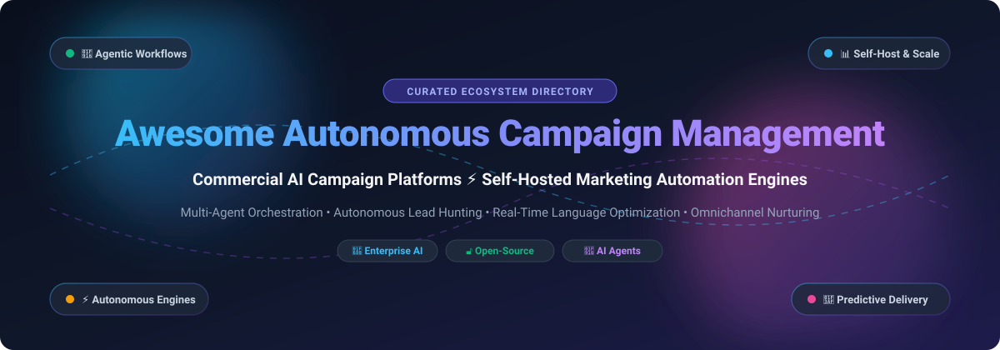

# Awesome-Autonomous-Campaign-Management

# Awesome-Autonomous-Campaign-Management 🚀 📣

  

  

  

  

  

  

  

---

## 🌟 Top Autonomous Campaign Management Ecosystem

**Curated List of Commercial AI Campaign Platforms & Open-Source Marketing Automation Frameworks**  

*Focused on Autonomous Campaign Creation, AI Agents, Multi-Channel Journeys, Language Optimization, Predictive Personalization & Self-Hosted Marketing Automation*

**Last updated: October 2026** 📅

---

### 📌 Overview & SEO Summary

Welcome to the ultimate curated directory of **autonomous campaign management platforms**, **open-source marketing automation frameworks**, and **AI-powered campaign agents**. Whether you are looking for enterprise-grade commercial solutions (such as *Salesforce Agentforce Campaigns*, *Zeta Global*, and *Braze*), or self-hostable open-source alternatives (like *Mautic*, *OpenCloser*, and *Apache Unomi*), this list covers category leaders, agentic workflows, and privacy-respecting campaign orchestration.

**Key Market Context:**

- **Salesforce Agentforce Campaigns** allows teams to **describe campaign goals in natural language** and Agentforce creates **audience segments, nurture flows, and campaign assets in minutes** — with **Marketing Cloud Next Growth Edition at $1,500/org/month** and **Advanced at $3,250/org/month** .

- **Zeta Global's AI Agents are now GA** with **400 hours of work saved per month** and **300% increase in month-over-month agent usage** — **Agentic Workflows in beta** allow chaining agents for customer journey optimization, campaign execution, and programmatic media buying .

- **Blueshift's Launchpad (Open Beta)** lets marketers **create segments, templates, campaigns, and dashboards using natural language** in a unified workspace, while **Campaign Optimizer Agent now supports SMS** with variant testing and automated winner selection .

- **Iterable's Nova Agents** (Review, Experimentation, Handlebars, Analytics) handle **execution work behind the scenes** — teams set the goal and agents handle QA, testing, and optimization automatically .

- **Braze's Conversational Agents (Beta)** replace keyword matching with **intelligent, on-brand dialogue** across WhatsApp, SMS, RCS, and web, with **Agentic Standards** for automated QA and **Message Prioritization** for cross-campaign coordination .

- **Persado** content outperforms human and other AI-generated copy **96% of the time**, improving customer engagement by **over 40%** , with **8 of the top 10 U.S. banks** relying on its Motivation AI .

- **Phrasee** optimizes language across the full customer journey with **natural language generation, machine learning, and dynamic optimization** — over **1 billion people across four continents** have responded to Phrasee-generated language .

- **Mautic** is the **world's first open-source marketing automation product** — **100% community-owned, no commercial entity behind it, true data sovereignty, and no license costs or lock-in** .

---

## 📑 Table of Contents

- [🏢 SaaS & Commercial Platforms](#-saas--commercial-platforms)

- [🔓 Open-Source GitHub Projects](#-open-source-github-projects)

- [🛠️ How to Contribute](#%EF%B8%8F-how-to-contribute)

- [📊 Star History](#-star-history)

- [🤝 Support & Sponsorship](#-support--sponsorship)

- [⚠️ Disclaimer](#%EF%B8%8F-disclaimer)

---

## 🏢 SaaS / Commercial Platforms

The autonomous campaign management market spans **CRM-native agentic platforms** (Salesforce Agentforce Campaigns) that **create campaigns from natural language briefs**, **AI-native marketing platforms** (Zeta Global, Blueshift, Iterable) that provide **autonomous agents for campaign execution, optimization, and QA**, and **language optimization platforms** (Persado, Phrasee) that focus on **AI-generated copy that outperforms human writing**. **Salesforce Marketing Cloud Next** starts at **$1,500/org/month** . **Zeta Global** saves **400 hours of work per month** with **300% agent usage growth** . **Braze's Agentic Standards** and **Message Prioritization** are planned for **October 2026** .

| SaaS / Commercial Platform | Company / Owner | Valuation / Market Cap | Standard Edition Starting Price | Free Tier / Free Trial Limits | Description |

| :--- | :--- | :--- | :--- | :--- | :--- |

| **[Salesforce Agentforce Campaigns](https://www.salesforce.com/marketing/)** ☁️ | Salesforce | ~$250 Billion | **$1,500/org/month** (Growth); **$3,250/org/month** (Advanced)  | **Free: Foundations tier with Flex Credits** | **CRM-native autonomous campaigns** — **Describe campaign goals in natural language and Agentforce creates audience segments, nurture flows, and campaign assets in minutes** . **Agentic conversations across email, SMS, and WhatsApp** — 24/7 lead nurturing, technical Q&A, recommendations, and meeting booking . **Data 360 integration** unifies marketing, sales, service, and commerce data for segmentation . |

| **[Zeta Global](https://zetaglobal.com/)** 🟢 | Zeta Global | ~$4 Billion | **Custom enterprise pricing** | **Demo available** | **AI Agents now GA** — **autonomous intelligent systems for QAing campaigns, building audiences, and providing insights** . **400 hours of work saved per month** with **300% increase in month-over-month agent usage** . **Agentic Workflows in beta** — chain AI agents for customer journey optimization, campaign execution, data onboarding, and programmatic media buying . |

| **[Blueshift](https://blueshift.com/)** 🔷 | Blueshift | Private | **Custom enterprise pricing** | **Demo available** | **Launchpad (Open Beta)** — **AI-powered workspace for creating segments, templates, campaigns, and dashboards using natural language** . **Campaign Optimizer Agent now supports SMS** — generate and test multiple SMS variants, review performance, and approve next test . **Customer AI Agents** — increased orders by 30% on abandonment campaigns, saved 60+ hours of marketing ops per month . |

| **[Iterable](https://iterable.com/)** 🟣 | Iterable | ~$2 Billion | **Custom enterprise pricing** | **Demo available** | **Nova Agents** — **coordinated system of goal-driven AI agents** that turn customer behavior into action . **Review Agent, Experimentation Agent, Handlebars Agent, Analytics Agent** handle execution work behind the scenes . **Command Center** — centralized, goal-based performance view . **Unknown User Activation** engages high-intent visitors before identification . |

| **[Braze](https://www.braze.com/)** 🟡 | Braze | ~$5 Billion | **Custom enterprise pricing** | **Free trial available** | **Conversational Agents (Beta)** — **intelligent, on-brand dialogue across WhatsApp, SMS, RCS, and web** . **Agentic Standards (October 2026)** — write QA rules once, automatically assess every campaign before launch . **Message Prioritization** — rank message categories and Braze holds that order across all campaigns . **Messaging Observability Dashboard** and **Canvas Threshold Alerts** . |

| **[Persado](https://www.persado.com/)** 🧠 | Persado | ~$97.5M raised | **Custom enterprise pricing** | **Demo available** | **Motivation AI for enterprise** — **content outperforms human and other AI-generated copy 96% of the time**, improving engagement by **over 40%** . **8 of the top 10 U.S. banks** rely on Persado . **Patented machine learning experimentation** with **regression-enabled transformer model** for performance prediction . **ISO27001, SOC II Type 2 audited** . |

| **[Phrasee](https://phrasee.co/)** 💜 | Phrasee | Private | **Custom enterprise pricing** | **Demo available** | **Language optimization platform** — **generates, optimizes, automates, and analyzes language in real time** . **1 billion+ people across four continents** have responded to Phrasee-generated language . **B2C brands including Domino's, eBay, FARFETCH, Groupon, Party City, and Walgreens** . |

| **[Albert AI](https://albert.ai/)** 🎯 | Zoomd (Acquired) | ~$50 Million | **Custom enterprise pricing** | **Demo available** | **Fully autonomous digital marketer** — **handles all elements of paid digital campaigns across channels** using RPA and AI . **Supports Fortune 500 companies** with human+machine digital advertising teams . **Multivariate testing and frequent data-oriented adjustments** . |

| **[Marketo Engage](https://business.adobe.com/products/marketo.html)** 🔵 | Adobe | ~$200 Billion | **Custom enterprise pricing** | **Demo available** | **AI-powered enterprise marketing automation** — **agentic user interface for omnichannel campaigns** . **Integrate AI tools and agents into existing workflows** . **Generative AI for email copy, subject lines, and Firefly-powered images** . **Multi-step campaigns with automatic adaptation to customer behavior** . |

---

## 🔓 Open-Source GitHub Projects

*Sorted by GitHub_Stars_Count (Descending)* 🌟

- **[Mautic](https://github.com/mautic/mautic)**   

  **World's first open-source marketing automation product**, GPL-3.0 licensed. **The definitive open-source marketing automation suite** — **100% community-owned with no commercial entity behind it, no investors to answer to** . **True data sovereignty** — you decide where it runs and which jurisdiction your data lives in . **Hundreds of developers, thousands of contributors, tens of thousands of live instances worldwide** . **No license costs, no lock-in** — self-hosting is unlimited, with hosting and SaaS providers offering different options including unlimited contacts . **Disciplined release planning with Long-Term Support and optional Extended LTS for years of stable, secure production** . **The most trusted open-source campaign management platform** . 🏛️

- **[OpenCloser](https://github.com/issacops/opencloser)**   

  **Open-source AI SDR & AI sales platform**, MIT licensed. **The most complete open-source AI sales team** — **AI Sales Strategist generates ICP using SPIN & Challenger frameworks** . **AI Lead Researcher does autonomous lead hunting with scoring and qualification, full local-first CRM with Kanban pipeline** . **AI Caller (SDR) is a real-time AI voice agent** powered by Google Gemini (also supports OpenAI Realtime and ElevenLabs ConvAI) with **built-in Twilio phone lines, live transcription, sentiment analysis, objection detection, and power dialing** . **AI Sales Coach offers objection sparring training with 3 difficulty levels and 12 objection archetypes** . **Runs fully in demo mode with no API key** . **Built with Tauri, React 19, Rust, and Gemini** . **Cost: Free vs $280–$1,000+/month per seat for SaaS alternatives** . 🚀

- **[Apache Unomi](https://github.com/apache/unomi)**   

  **Open-source customer data platform and campaign personalization engine**, Apache-2.0 licensed. **Apache Software Foundation top-level project** — **provides a customer data platform (CDP) with REST APIs for building campaign management and personalization systems** . **Profile, segment, and rule-based personalization** . **The most established open-source CDP for campaign management** . 🎯

- **[OpenCloser (issacops/opencloser-v2)](https://github.com/issacops/opencloser-v2)**   

  **Open-source AI SDR & sales platform v2**, MIT licensed. **AI Sales Strategist, AI Lead Researcher, AI Caller (SDR), AI Sales Coach, and AI Sales Manager** . **Runs fully in demo mode with no API key** — 10 realistic seed leads, simulated AI calls . **Tauri + React 19 + Rust + Gemini** . **The most complete open-source autonomous campaign and outreach platform** . 🎯

- **[Mautic (Mautic Community)](https://github.com/mautic/mautic)**   

  **Full-blown free and open-source marketing automation suite**, GPL-3.0 licensed. **Campaign builder, email marketing, landing pages, forms, lead scoring, and CRM integrations** . **Self-hosted unlimited** . **The most complete open-source alternative to HubSpot and Marketo** . 📧

- **[Smartlead](https://github.com/smartlead-ai/smartlead)**   

  **Cold email infrastructure with autonomous agents**, open-source. **SmartProspect, SmartDelivery, SmartAgents** for autonomous prospecting . **Dedicated infrastructure (SmartInfra) at ~$39/server/month** . **Client Access for agency collaboration** . **The most complete open-source cold outreach platform** . 📨

- **[ColdScout](https://github.com/colddsam/coldscout)**   

  **Autonomous AI-powered B2B lead generation SaaS**, open-source. **Discovers local businesses via Google Places, qualifies with Groq Llama 3, and sends hyper-personalized cold email campaigns** . **Pipeline stages independently schedulable via jobs_config.json** . **Built with FastAPI, React 19, PostgreSQL, Supabase Auth, and Razorpay billing** . 🎯

- **[Warmbly](https://github.com/warmbly/warmbly)**   

  **Largest open-source B2B cold outreach and email warmup service**, open-source. **Runs cold email campaigns from mailboxes you already own and warms them so they keep landing in the inbox** . **Multi-step sequences, unified inbox, CRM with pipelines, deliverability management, visual reply playbooks** . **Self-hosting with no cloud account** — one command brings up the whole platform . 🛡️

- **[OpenCloser (GitHub)](https://github.com/issacops/opencloser)**   

  **Open-source AI SDR & AI sales platform**, MIT licensed. **AI Sales Strategist, AI Lead Researcher, AI Caller, AI Sales Coach, AI Sales Manager** . **Runs fully in demo mode with no API key** . **Tauri + React 19 + Rust + Gemini** . 🚀

---

## 🛠️ How to Contribute

Contributions are welcome! Follow these steps to submit new autonomous campaign management platforms or open-source marketing automation software:

1. 🍴 **Fork** the repository.

2. 📝 **Add/edit** entries in `README.md` maintaining table/list structure and formatting.

3. 🔗 Include project title, official website/GitHub link, exact Stars_Count, license, and brief description.

4. 🚀 Submit a **Pull Request** with a descriptive summary of your changes.

---

## 📊 Star History

---

## 🤝 Support & Sponsorship

If you find this autonomous campaign management repository useful, please consider supporting the project:

- ⭐ **Star** this repository to increase visibility!

- 🔀 **Fork** and share with fellow marketers, growth leaders, and open-source advocates.

- ☕ **Sponsor & Buy Me a Coffee**: Support ongoing open-source curation via the [GitHub Sponsor Dashboard](https://github.com/sponsors/ishandutta2007).

---

## ⚠️ Disclaimer

- This is a **community-curated** list — not exhaustive and not an endorsement. ℹ️

- **Salesforce Marketing Cloud Next requires an annual contract** — **Growth at $1,500/org/month and Advanced at $3,250/org/month** . **Agentforce Campaigns is built on the same Salesforce platform as Sales, Service, and Commerce**, enabling unified data and AI agents .

- **Zeta Global's Agentic Workflows are in beta** — **contact your Zeta Account Manager to test** . **Braze's Conversational Agents are in beta** — **contact your Braze account team to join** . **Blueshift's Launchpad is in open beta** as of March 2026 .

- **Mautic is the world's first open-source marketing automation product** — **100% community-owned, no commercial entity behind it, and designed to stay that way** . **True data sovereignty** — you decide where it runs and which jurisdiction your data lives in .

- **Always validate campaign automation, AI-generated content quality, and deliverability with a proof-of-concept** before production deployment. Autonomous agents can send thousands of messages — **ensure brand guidelines, compliance rules, and suppression lists are enforced** before going live. 📣

---

  <b>Made with ❤️ for marketers, growth leaders, and open-source campaign management advocates.</b>

